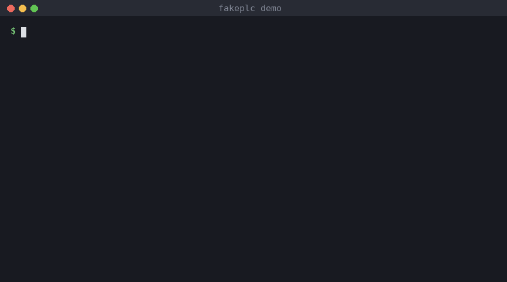

# fakeplc

[](https://github.com/DanShinde/fakeplc/actions/workflows/ci.yml)
[](https://pypi.org/project/fakeplc/)
[](https://pypi.org/project/fakeplc/)
[](LICENSE)

**A fake PLC for your test suite.** One YAML file gives you a PLC that speaks
**OPC UA** and **Modbus TCP** at the same time, plus a pytest plugin, so code
that talks to PLCs (SCADA, HMIs, Django and FastAPI dashboards, gateways, data
loggers) can be tested in CI without hardware.



```python
import pytest

pytestmark = pytest.mark.fakeplc("line1.yaml")

def test_start_button_starts_the_motor(fake_plc):
    start_line(fake_plc.modbus_host, fake_plc.modbus_port)   # your code
    assert fake_plc.writes("Motor.Start") == [True]           # what it wrote
    fake_plc.scan(5)                                          # five PLC scans, no sleep()
    assert fake_plc.get("Motor.Speed") == 750.0
```

## Why fakeplc

- **One tag, two protocols.** `Tank.Level` is OPC UA node `ns=2;s=Tank.Level`
  *and* holding registers 0 to 1. Write it over Modbus, read it over OPC UA, as on
  a real PLC.
- **Assert what your app did.** Every client write is recorded with tag, value
  and protocol: `fake_plc.writes("Pump.Setpoint") == [12.5]`.
- **No flaky sleeps.** Simulated signals and logic run on PLC scans. Tests call
  `scan(n)` and get the same result every time, however slow the CI runner is.
- **Fast.** One server per config for the whole test session, reset before each
  test in milliseconds.
- **PLC logic without Python.** One-line rules such as
  `Motor.Running = Motor.Start and not Motor.Fault`, checked by a safe
  expression evaluator (no `eval`).

## Install

```bash
pip install fakeplc
```

Python 3.10 or newer. OPC UA comes from [asyncua](https://github.com/FreeOpcUa/opcua-asyncio);
the Modbus TCP server is built in and has no extra dependencies.

## Docker

A ready-made image is published to `ghcr.io/danshinde/fakeplc` on every version tag
(linux/amd64 and linux/arm64), so non-Python tools (Node-RED, Grafana, Ignition,
docker-compose demos) can start a fake PLC with one line:

```console
$ docker run --rm -p 4840:4840 -p 5020:5020 ghcr.io/danshinde/fakeplc
# serves the bundled examples/line1.yaml: OPC UA on 4840, Modbus TCP on 5020

$ docker run --rm -p 4840:4840 -p 5020:5020 -v "$PWD/plc.yaml:/plc.yaml" \
    ghcr.io/danshinde/fakeplc serve /plc.yaml --host 0.0.0.0
```

The image is built from `python:3.13-slim` and installs the package from the checkout at build time (`pip install .` in the Dockerfile — not `pip install fakeplc` at runtime), with `ENTRYPOINT ["fakeplc"]`,
so anything after the image name is passed to the `fakeplc` CLI; the default command
serves `examples/line1.yaml`. Build it yourself with `docker build -t fakeplc .`.

## Quick start

`line1.yaml`:

```yaml
plc: line1
scan_ms: 100            # one PLC scan every 100 ms
opcua:  {port: 4840}    # 0 = any free port, false = off
modbus: {port: 5020, word_order: big}

tags:
  Motor.Start:   {type: bool, modbus: coil 0}
  Motor.Fault:   {type: bool, modbus: coil 1}
  Motor.Running: {type: bool, modbus: discrete 0}
  Motor.Speed:   {type: real, modbus: input 0, unit: rpm}
  Tank.Level:    {type: real, modbus: holding 0, value: 42.5}
  Pump.Setpoint: {type: real, modbus: holding 2}
  Batch.Count:   {type: dint, modbus: holding 4}
  Line.Temp:     {type: real, modbus: input 2, sim: "noise(21.5, 0.3)"}

logic:
  - Motor.Running = Motor.Start and not Motor.Fault
  - Motor.Speed = min(Motor.Speed + 150, 1500) if Motor.Running else 0
  - Batch.Count = Batch.Count + 1 if Motor.Running else Batch.Count
```

Run it:

```console
$ fakeplc serve line1.yaml
fakeplc 0.1.0: PLC 'line1' with 8 tags
  OPC UA      opc.tcp://127.0.0.1:4840   node ids ns=2;s=<tag>
  Modbus TCP  127.0.0.1:5020   word order big
  Scan        every 100 ms

TAG            TYPE  MODBUS      ACCESS      START  SOURCE
Motor.Start    bool  coil 0      read/write  False
...
Press Ctrl+C to stop.
14:02:11.480  modbus wrote Motor.Start = True
14:02:15.122  opcua  wrote Pump.Setpoint = 12.5
```

Point any OPC UA or Modbus client at it (UaExpert, Node-RED, Ignition, pymodbus,
asyncua). Client writes are printed as they happen.

## In pytest

Installing fakeplc adds two fixtures.

| Fixture | What you get |
| --- | --- |
| `fake_plc` | A running PLC, reset to its start values before the test. One server per config for the whole session. |
| `fake_plc_factory(config, **kwargs)` | Extra PLCs (path or dict), stopped when the test ends. |

Choose the config, in order of priority:

```python
@pytest.mark.fakeplc("line1.yaml")          # relative to the test file, or a dict
```

```console
pytest --fakeplc tests/line1.yaml
```

```ini
[pytest]
fakeplc_config = tests/line1.yaml           # relative to rootdir
```

Under pytest, ports are picked free (so `pytest-xdist` works) and scans only run
when the test calls `scan()`. Use `@pytest.mark.fakeplc("x.yaml", keep_ports=True)`
to keep the ports from the file, and `autoscan=True` for a free-running PLC.

Give the addresses to the code under test, for example with pytest-django:

```python
@pytest.fixture(autouse=True)
def plc_settings(settings, fake_plc):
    settings.PLC_OPCUA_URL = fake_plc.opcua_url
    settings.PLC_MODBUS_PORT = fake_plc.modbus_port
```

### The PLC API

| Call | Does |
| --- | --- |
| `get(tag)`, `values()` | Current value of one tag, or all |
| `set(tag, value)`, `set_many({...})` | Force values, as the PLC program would (not journaled) |
| `scan(n=1)` | Run n scans: `sim` signals, then `logic` rules in order |
| `writes(tag, protocol=None)` | Values clients wrote to a tag, oldest first |
| `journal(tag=None, protocol=None)` | Full `Write` records: tag, value, protocol, timestamp, scan |
| `wait_for(tag, value_or_predicate, timeout=5, written=False)` | Wait for a value, or for a client write with `written=True` |
| `await wait_for_async(...)` | The same for async tests |
| `reset()` | Start values back, journal cleared, simulated time to zero |
| `opcua_url`, `node_id(tag)`, `modbus_host`, `modbus_port` | Where to connect |

`FakePLC` also works outside pytest:

```python
from fakeplc import FakePLC

with FakePLC("line1.yaml", autoscan=False) as plc:
    ...
```

## YAML reference

| Key | Default | Meaning |
| --- | --- | --- |
| `plc` | `plc` | Name; the OPC UA folder under Objects |
| `scan_ms` | `100` | Scan period; simulated time `t` advances by this per scan |
| `autoscan` | `true` | Scan on a timer (`fakeplc serve`); pytest turns it off |
| `seed` | `0` | Seed for `noise()` |
| `opcua.port` / `host` / `namespace` | `4840` / `127.0.0.1` / `urn:fakeplc` | `port: false` turns OPC UA off |
| `modbus.port` / `host` | `5020` / `127.0.0.1` | `port: false` turns Modbus off |
| `modbus.word_order` | `big` | `big` = high word first (AB CD), `little` = CD AB |
| `modbus.unmapped` | `error` | Reads of unmapped addresses: `error` (exception 02) or `zero` |

**Tags.** Names are dotted (`Area.Machine.Signal`); the dots become OPC UA
folders. Each tag has:

| Field | Values |
| --- | --- |
| `type` | `bool`, `int` (16 bit), `uint`, `dint` (32 bit), `udint`, `real` (float32), `lreal` (float64) |
| `modbus` | `coil N`, `discrete N`, `holding N`, `input N` (0-based); 32-bit types take 2 registers, `lreal` 4 |
| `value` | Start value |
| `readonly` | Default: true for discrete inputs, input registers and tags driven by `sim` or `logic` |
| `sim` | Expression evaluated every scan |
| `unit`, `description` | Free text; `description` shows in OPC UA |

**Expressions** (`sim` and `logic`) use tag names, `t` (simulated seconds),
numbers, `+ - * / // % **`, comparisons, `and or not`, `x if cond else y`, and
these functions:

| Function | Value |
| --- | --- |
| `sine(amplitude=1, period=10, offset=0)` | Sine wave over `t` |
| `ramp(low=0, high=100, period=10)` | Sawtooth from low to high |
| `square(low=0, high=1, period=10)` | Square wave |
| `noise(center=0, spread=1)` | Random within ±spread, repeatable with `seed` |
| `counter(step=1, period=1)` | Counts up every period |
| `limit(x, low, high)`, `min`, `max`, `abs`, `round`, `int`, `float`, `bool` | Helpers |

Logic rules run in order every scan, each seeing the results of the rules
before it, like rungs in a PLC program.

`fakeplc check line1.yaml` validates a file and prints its tag table.

## Modbus details

Function codes 1, 2, 3, 4, 5, 6, 15 and 16. Any unit id is answered. A write
that touches an unmapped or read-only address is rejected with exception 02 and
changes nothing, even when it spans several tags. Writing one half of a 32-bit
value with function 6 updates that half.

## When to use something else

- [opcua-sim](https://pypi.org/project/opcua-sim/) simulates OPC UA *devices*
  with alarms, NE 107 health and fault injection. Pick it when you test OPC UA
  edge cases in depth; pick fakeplc when you need a PLC tag table over both
  protocols and test assertions on what your app wrote.
- pymodbus ships a Modbus simulator with a web UI, without OPC UA.

## Related projects

- [tagbridge](https://github.com/DanShinde/tagbridge) bridges Modbus and OPC UA tags to MQTT (Sparkplug B). Its demo runs against `examples/line1.yaml`.

## Roadmap

- Docker image `ghcr.io/danshinde/fakeplc`
- String and array tags
- Siemens S7 protocol (snap7)
- OPC UA security and users
- Record from a real PLC and replay

Ideas and bug reports are welcome in the [issues](https://github.com/DanShinde/fakeplc/issues).

## Development

```bash
git clone https://github.com/DanShinde/fakeplc
cd fakeplc
pip install -e ".[test]" ruff mypy
pytest
ruff check . && ruff format --check . && mypy
```

## Contributing

See [CONTRIBUTING.md](CONTRIBUTING.md). Issues labelled
[good first issue](https://github.com/DanShinde/fakeplc/labels/good%20first%20issue) are a good place to start.

## License

MIT
